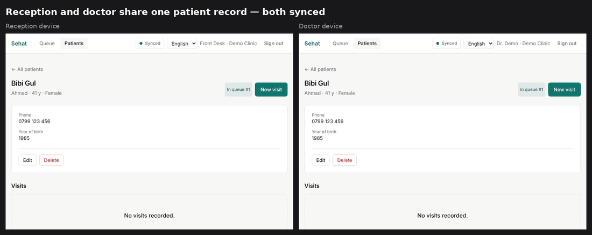

# Sehat

**Offline-first patient records for small clinics.**



Many clinics in Afghanistan and Pakistan still run on paper, because internet and power cuts make online software unreliable. Sehat keeps working with no connection and syncs automatically when the connection returns, merging edits made on different devices without losing data.

## Features

- Patient registration, visit notes, vitals and printable prescriptions
- Daily patient queue shared between reception and doctors
- Allergy warnings on the patient profile, visit form and printout
- Fully functional offline (installable PWA); background sync when online
- Field-level conflict resolution with hybrid logical clocks
- Clinic accounts with admin, doctor and reception roles
- English, Dari and Pashto, with right-to-left layout

## Architecture

```
┌──────────── Browser ────────────┐          ┌──────── Server ────────┐
│  UI  →  Store  →  IndexedDB      │  /sync   │  Next.js route         │
│            ↘ outbox → SyncEngine ├─────────►│  merge → Postgres      │
│                      ◄───────────┤  pull    │  (seq cursor, lock)    │
└──────────────────────────────────┘          └────────────────────────┘
```

The merge logic in `src/lib/sync` is shared by client and server. See [docs/sync.md](docs/sync.md) for the design and its trade-offs.

| Path | |
| --- | --- |
| `src/lib/sync` | Hybrid logical clock, merge, protocol schemas |
| `src/lib/domain.ts` | Collections and field validation |
| `src/server` | Postgres schema (Drizzle), sync service, auth |
| `src/client` | IndexedDB store (Dexie), outbox, sync engine |
| `src/app` | Next.js pages and API routes |
| `public/sw.js` | Service worker that serves the app shell offline |

Every page is statically rendered and reads record ids from the query string (`/patient?id=…`), so the service worker can serve any screen from cache with no server round trip.

## Getting started

```bash
npm install
npm run db:seed   # creates a demo clinic in an embedded database
npm run dev
```

No database setup is needed for development: without `DATABASE_URL`, Sehat uses an embedded Postgres ([PGlite](https://pglite.dev)) stored in `.data/`. Sign in with `demo.reception`, `demo.doctor` or `demo.admin`, password `sehat-demo`.

For production, set `DATABASE_URL` to a Postgres database and `AUTH_SECRET` to a random 32+ character string, then run `npm run db:migrate`.

## Testing

```bash
npm test
```

Tests run against a real Postgres engine in memory and simulate multiple offline devices syncing through the actual server code, including concurrent edits, edits made mid-sync, and invalid records that must not block the outbox.

## Tech

Next.js · TypeScript · Tailwind CSS · Dexie (IndexedDB) · Drizzle ORM · PostgreSQL · Zod · Vitest
